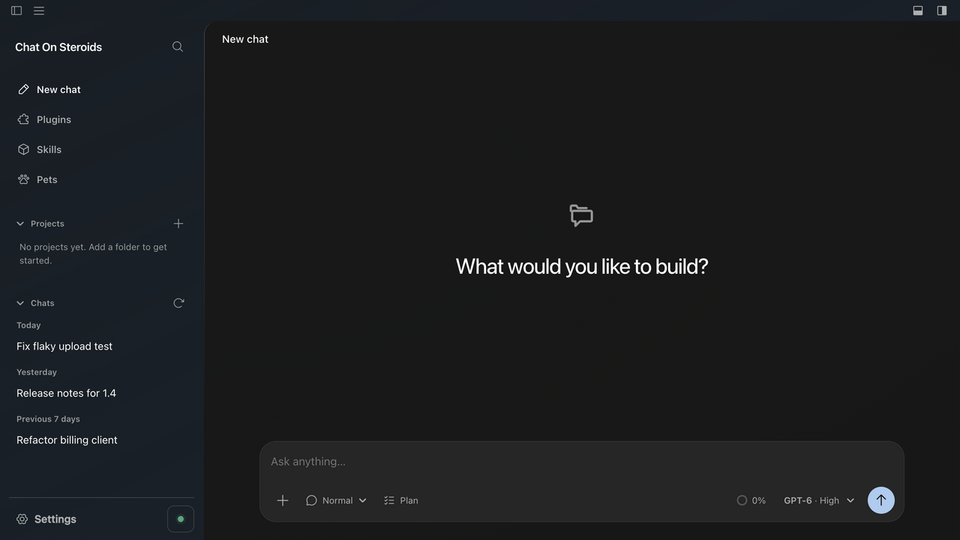
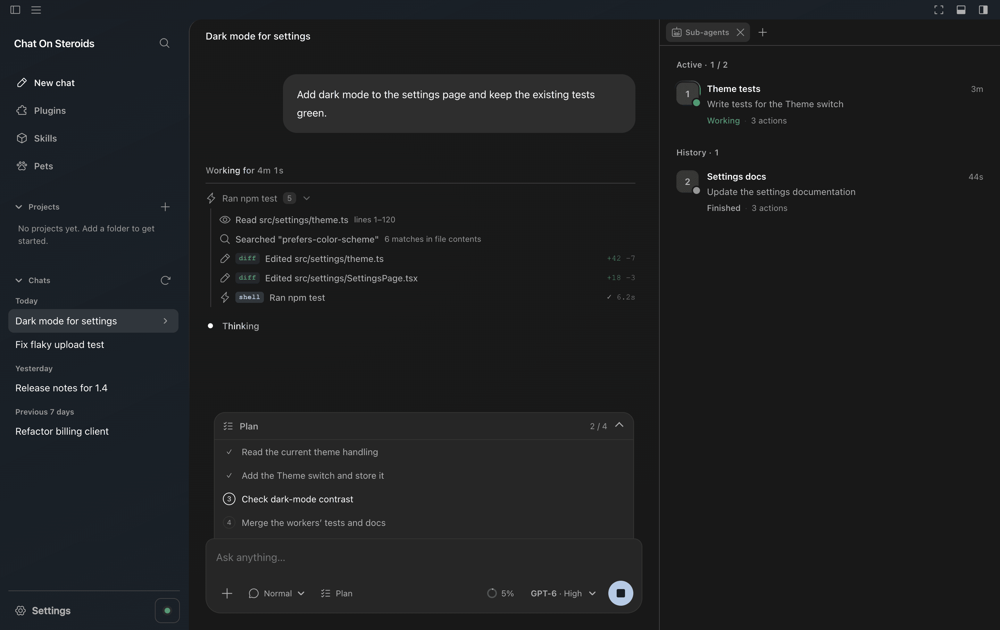
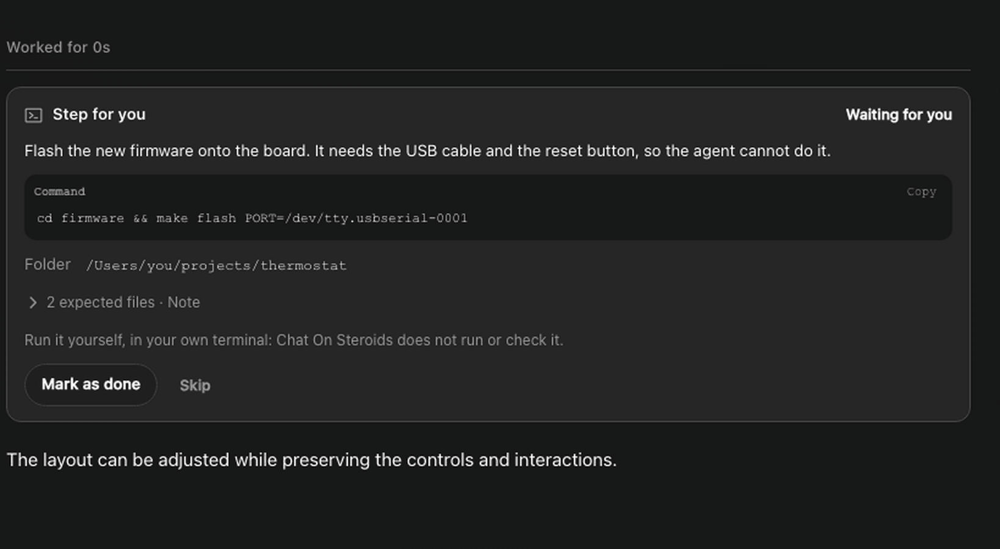
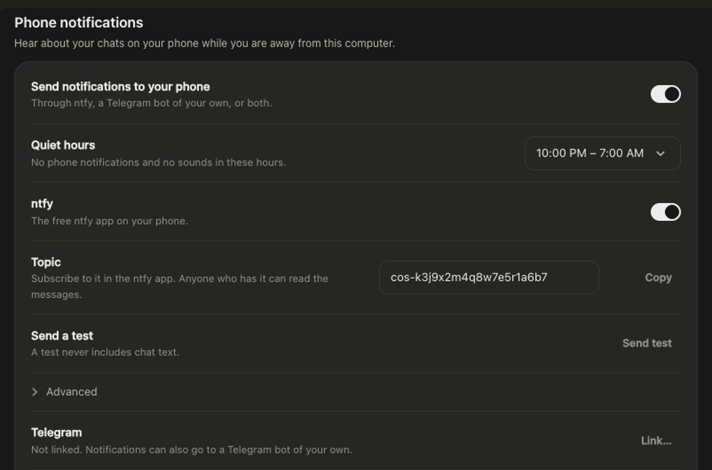
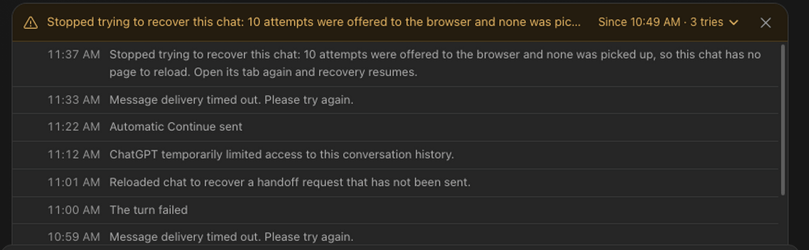
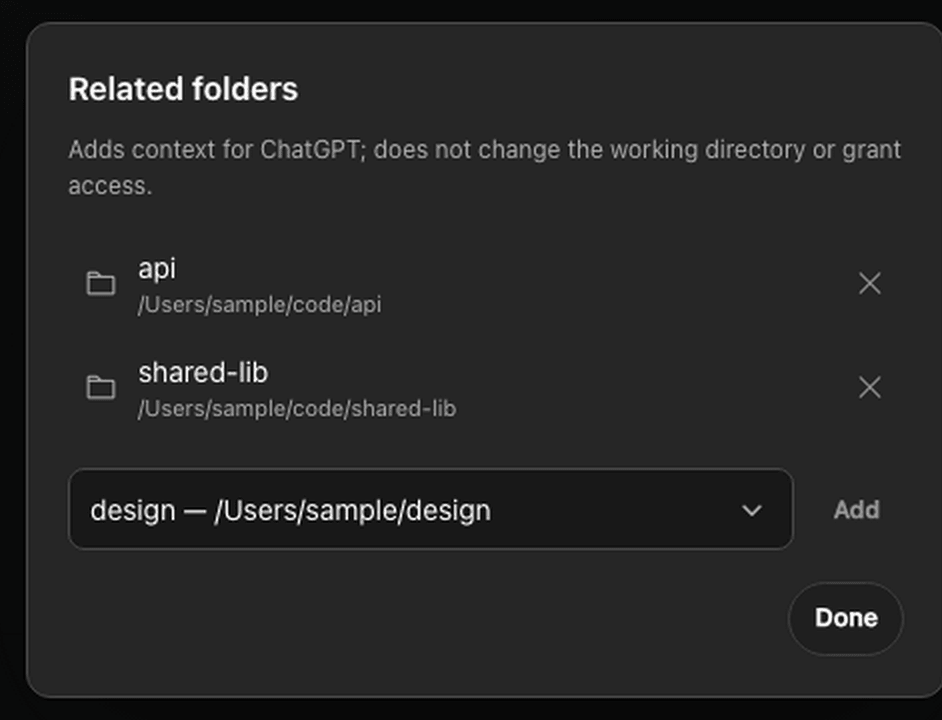
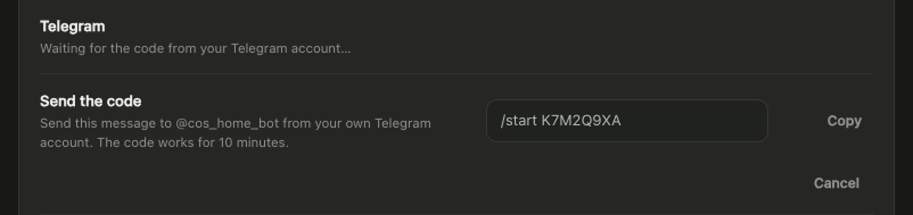
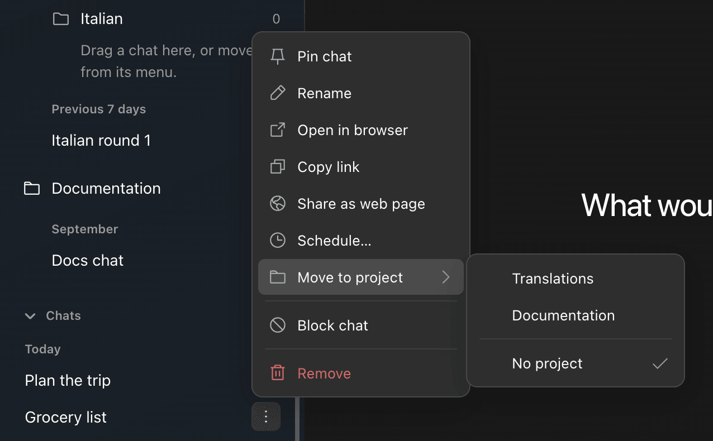
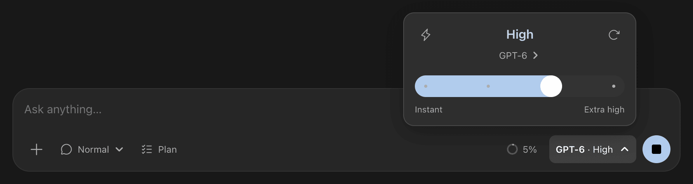
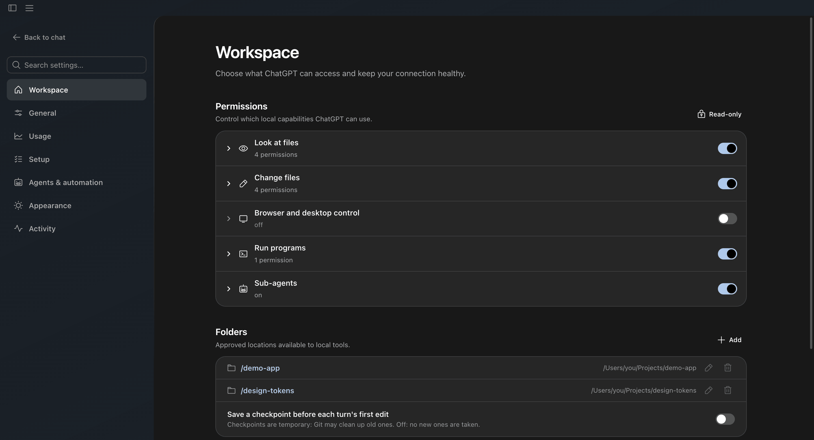

  &nbsp;
  &nbsp;
  

<a href="https://github.com/totec448-spec/chat-on-steroids/releases/latest">All downloads</a>

Independent beta. Use at your own risk and within your provider's rules. <a href="#responsible-use-and-provider-rules">Read the usage notice</a> before connecting.

 

<a href="#get-started">Get started</a> &nbsp;·&nbsp; <a href="docs/images/demo.mp4">Watch the demo</a> &nbsp;·&nbsp; <a href="CHANGELOG.md">What’s new</a>

 

<h2 align="center">Code. Delegate. Keep going.</h2>

**Work on the real project.** Let ChatGPT read and edit files, run tests, keep terminals open and use your desktop. Follow the actual tool results as they arrive.

**Give it a team.** Split independent jobs across workers, then bring their results back. Workers keep their context, so the next task can pick up where they left off.

**Stay in control of long tasks.** Send a correction while work runs. Goal follows unfinished work; Loop keeps working within your brief. Compact & Resume carries the session and worker history into a fresh chat.

<strong>Uses your ChatGPT conversation rather than invoking Codex directly.</strong> ChatGPT Work and Codex share usage limits. Your account’s model availability, usage and context limits still apply. <a href="https://learn.chatgpt.com/docs/pricing">OpenAI usage details →</a>

 

## What you get

<table>
<tr>
<td width="50%" valign="top">

### When it needs a human, it says so
Some steps only you can do: a sign-in, a USB key, a command it must not run. ChatGPT hands you a **step for you**, with the exact command, the folder and what it expects to see. You run it yourself and mark it **done**; the app never runs it.

</td>
<td width="50%" valign="top">

### Know what your chats are doing, away from your desk
Get a message when a chat finishes, needs you or fails, through the free **ntfy** app or a **Telegram bot of your own**. With Telegram you can also ask `/status`, stop or pause a chat, and deny an approval from your phone. Nothing can be allowed remotely.

</td>
</tr>
<tr>
<td width="50%" valign="top">

### When a chat is stuck, one row tells you why
Since when, how often the app tried, and every step it took. It turns amber once the app has stopped trying, so you know when it needs you.

</td>
<td width="50%" valign="top">

### Give a project more context, not more access
Add related folders to a project so ChatGPT knows about them. They never become the working folder and never widen what it may touch.

</td>
</tr>
<tr>
<td width="50%" valign="top">

### Link your own Telegram bot in a minute
Create a bot with @BotFather, paste its token, and send the shown code to it. Notifications then also arrive in Telegram. ntfy keeps working until you turn its switch off in the phone notification settings, and with "Include chat names and answers" on, either one can carry chat names and answers.

</td>
<td width="50%" valign="top">

### Keep chats in projects
Move a chat into a project from its menu or by dragging it, and undo it right away. Chats are grouped by date, and a project's folder is where its chats work.

</td>
</tr>
</table>

- **Pick the model and effort per chat**, with the same controls ChatGPT offers.
- **Folders you control.** Choose exactly which folders ChatGPT may touch, and what it may do there.
- **Limit how many chats work at once**, so a busy day does not hit your usage in one burst.
- **Command output in a dock.** Watch what a running command prints, read-only, and stop it with one click.
- **Skills, plugins and pets**, 13 languages, light and dark.

## Responsible use and provider rules

Chat On Steroids is an independent, open-source workspace for coding and other authorized tasks with your own files and tools. It is intended to support productive work within the rules of the services you use. **It is not intended to bypass usage limits, account restrictions or safety controls.**

Use CoS in accordance with OpenAI's applicable [Terms of Use](https://openai.com/policies/terms-of-use/) ([Europe Terms](https://openai.com/policies/eu-terms-of-use/) for the EEA, Switzerland and UK), [Usage Policies](https://openai.com/policies/usage-policies/) and [Service Terms](https://openai.com/policies/service-terms/), plus your workspace's rules and any connected service's terms.

- **Respect limits and access decisions.** Workers, Goal/Loop, Compact & Resume and finish checkpoints organize work; they do not grant extra quota or model access and must not be used to evade rate limits, usage caps or account restrictions. Do not switch accounts, chats, plugins or tunnels to evade a restriction.
- **Respect safety decisions.** Do not use local tools, browser control, plugins or another worker to carry out an action that the provider blocked for safety. A local permission or an enabled MCP plugin is not permission to override a provider refusal.
- **Understand the integration.** CoS connects local tools through MCP. Its browser extension also observes and automates the ChatGPT browser UI and records conversation content locally. This browser integration is not a public ChatGPT automation API. MCP availability does not establish permission for every form of browser automation or recording; OpenAI's terms also restrict automated or programmatic extraction of data or output.
- **Use at your own risk.** Review the rules for your account and intended workflow before connecting, supervise automation and review tool actions and outputs. CoS cannot guarantee policy compliance, continued service access or protection from account warnings, restrictions or suspension. If a workflow is restricted or receives a policy warning, stop that workflow and seek clarification through the provider's support or appeal process.

This notice states the project's intended use; it does not certify compliance or change provider rules. CoS is not affiliated with, endorsed by or approved by OpenAI. The software is provided as-is under the [MIT license](LICENSE); applicable statutory rights remain unaffected. See [Security](SECURITY.md) for local permissions and risks.

 

## Get started

1. **Install CoS** and open **Settings → Setup**. It walks you through seven short steps, with pictures of what to click.
2. **Connect your browser** (step 1): load the browser extension in Chrome, Edge or Brave. Setup shows your browser's own extensions page in your language: turn on **Developer mode**, click **Load unpacked** and choose the folder that **Open extension folder** shows. Pairing is automatic.
3. **Share a folder and choose access** (steps 2–3): the folder ChatGPT may work in, and what it may do there.
4. **Connect Core** (steps 4–7): create a tunnel and a restricted API key at OpenAI, press **Connect**, then add the app in ChatGPT under **Plugins → Add → Add custom MCP server**. [Tunnel setup →](docs/setup.md#tunnel-setup)
5. **Choose a model, write your task and send.**

Requirements &amp; installation notes

Windows 10/11, **macOS 13 Ventura or newer**, or a current desktop Linux. Chrome 125+, current Edge or Brave, plus a ChatGPT account/workspace that can create custom MCP apps (availability depends on your plan and workspace policy). [Check account availability](https://help.openai.com/en/articles/12584461-developer-mode-and-mcp-apps-in-chatgpt).

- **Unsigned beta:** Windows is not publisher-signed; macOS is unsigned and unnotarized. Verify the package against the release checksums. Because of that, macOS asks once after each update for your login password so the new version can open its saved keys ("chat-on-steroids Safe Storage"); choose **Always Allow**. Until you answer, chats and the browser connection wait, and the app says so.
- **Linux:** a Secret Service keyring is required. Prefer the DEB; when unprivileged user namespaces are disabled, the AppImage launcher can fall back to <code>--no-sandbox</code>.
- **Permissions:** choose your approved folders and review capabilities before connecting. Fresh installs enable Core capabilities and two workers; Windows also enables Desktop permissions. Shell commands run with your normal user privileges.
- **Languages:** English, German, Spanish, French, Korean, Portuguese (Brazil and Portugal), Russian, Turkish, Vietnamese, Japanese, and Simplified and Traditional Chinese. Choose one in **Appearance → Language**.
- **After updating:** the browser extension updates itself once no chat is busy. If CoS asks you to refresh its apps in ChatGPT, do so; **Automatic plugin refresh** in Settings can do it for you.

Folder and capability settings

 

---

<a href="docs/setup.md">Setup &amp; help</a> &nbsp;·&nbsp; <a href="docs/README.md">Docs</a> &nbsp;·&nbsp; <a href="docs/plugins.md">Plugins</a> &nbsp;·&nbsp; <a href="CONTRIBUTING.md">Contribute</a> &nbsp;·&nbsp; <a href="SECURITY.md">Security</a> &nbsp;·&nbsp; <a href="LICENSE">MIT license</a>

Built with our <a href="CONTRIBUTORS.md">community contributors</a>. Thank you to the people behind the code, designs, bug reports and testing.

Not affiliated with or endorsed by OpenAI. ChatGPT and Codex are OpenAI trademarks.

