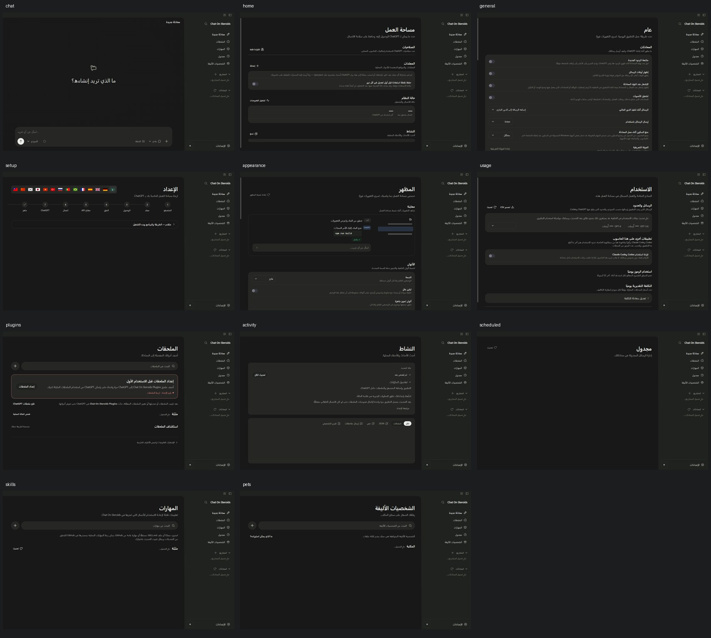
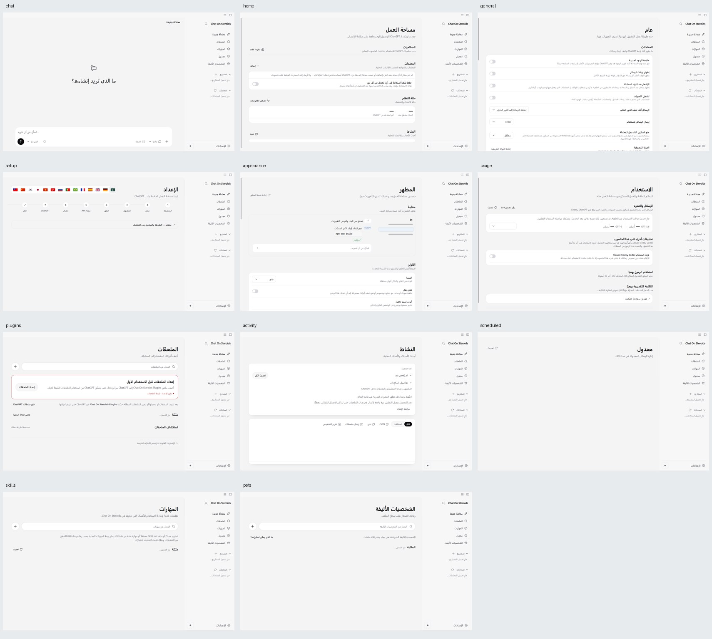

# Arabic UI and Language QA — 12 November 2026

This is a **localized rendering and editorial QA report**, not a claim that every authenticated COS tool or external website was exercised. The verified Windows preview runs with its own profile; the officially installed application and the user's accounts were not modified.

## Visual scope

- Isolated production renderer: 11 primary pages (Chat, Workspace, General, Setup, Appearance, Usage, Plugins, Activity, Scheduled, Skills, Pets) in Arabic RTL, at viewport widths 1280, 900 and 760px in **both light and dark** = **66 page captures**. These are real Chromium frames from a synthetic fixture, not mocked images.
- Additional layout assertions at **125% and 150% zoom** on the Chat, General, Setup, Appearance and Plugins pages across those three widths.
- Verified the genuine Phosphor icon font loads in the fixture before taking a screenshot (avoids previously misleading missing-glyph squares).
- Inspected the standalone packaged Windows Arabic preview's composer mode and attachments menus. The corrected popovers now open inward and no longer clip behind the mirrored sidebar.
- English/Arabic browser-extension popup smoke test, with technical request/chat identifiers forced LTR and bidi-isolated.
- Sidebar layout selector: four genuine **Arabic** screenshots (Projects/Inbox × Light/Dark), captured from the production renderer using invented projects/chat titles. These replace the English fallback cards for Arabic.
- Additional interaction/regression scripts cover settings layout, accessibility, composer layout, composer UI, dropdown layout and chat widths.

**Visual overviews (synthetic, no user content):**

## Human-style editorial review of Arabic copy

- Checked the renderer's **4,333** Arabic catalog entries (3,913 base entries plus 420 Arabic plural forms, including one new error template) for structural consistency and editorially reviewed safety-sensitive/recovery, setup, data permissions, destructive actions, agent roles and time/scheduling language against their source/usage points.
- Updated the four trust/block error messages to name the *actual* translated row actions: «الوثوق بالمحادثة» and «إلغاء حظر المحادثة».
- Corrected project-folder permission wording: approval no longer incorrectly implies external sharing; recording is described as its own configurable permission.
- Made technical setup instructions bilingual (Arabic meaning plus the exact English label visible on third-party pages), so users can find Tunnels, Restricted, Create and No authentication.
- Clarified that **Session Finish** refers to an explicit tool/hold boundary rather than a closed ChatGPT session.
- Reviewed all **84** Arabic plural groups. Fixed the visibly incorrect counted minute/hour/day forms and rewrote a further set of number-bearing strings into neutral Arabic forms that do not break for 3–10 or 11–99.
- Aligned browser extension screen-reader cancellation, tool-row overwrite and advanced diagnostic terminology with app behavior.
- Translated a dynamically assembled **browser-not-found / model-discovery** error; added the same new key to every other existing locale to avoid introducing an English-only message.

## Automated evidence

- `npm run typecheck` — passed.
- Arabic renderer+browser extension RTL smoke tests — passed.
- 8 focused test files covering Arabic quality, extension, renderer catalog and row-menu geometry — **154/154 passed** on the current revision (before any later source edits).
- 9 broader relevant test files, including full renderer timeline — **276/276 passed** (before the last editorial harmonization).
- Relevant Windows UI smoke scripts: settings-layout, accessibility, composer-layout, dropdown-layout, chat-width, composer-ui — **6/6 passed**.
- Isolated Windows packaged-resource smoke test passed after rebuilding the standalone Arabic preview with the current editorial and RTL changes. A follow-up live preview check confirmed the dynamically constructed missing-browser error is now Arabic.

## Known limits and follow-up

- Third-party browser setup screenshots (Chrome/Edge/Brave Developer mode and Load unpacked) use an **English source capture** when no Arabic-native browser screenshots are available. Instructions are bilingual to preserve discoverability. Creating real localized native screenshots needs the matching Arabic browser UI.
- Real ChatGPT sessions, provider entitlements, connected tools, cloud infrastructure, live Android/mobile installations, account sign-ins and macOS/Linux native builds are outside this isolated UI/language audit. We did not attach, send messages or modify user content.
- The complete monorepo `npm run verify` initially reported **12,086 passing tests, 10 failures and 179 skips** in a large parallel Windows run, including four checks written/modified mid-run and six unrelated shell/state timing or runtime tests. All changed localization tests have since passed. The six unrelated files were **re-run with one worker: 336 passed, six skipped, zero failed**. This strongly suggests that run's remaining failures were concurrency/environment-sensitive, but **a fresh full green `npm run verify` run and upstream CI are still outstanding**.
- This is a technical/editorial review, **not** an independent accredited native-language review or final upstream maintainer approval.

PR should remain a Draft until the project maintainers approve the visual/copy evidence and its own CI reports success.
