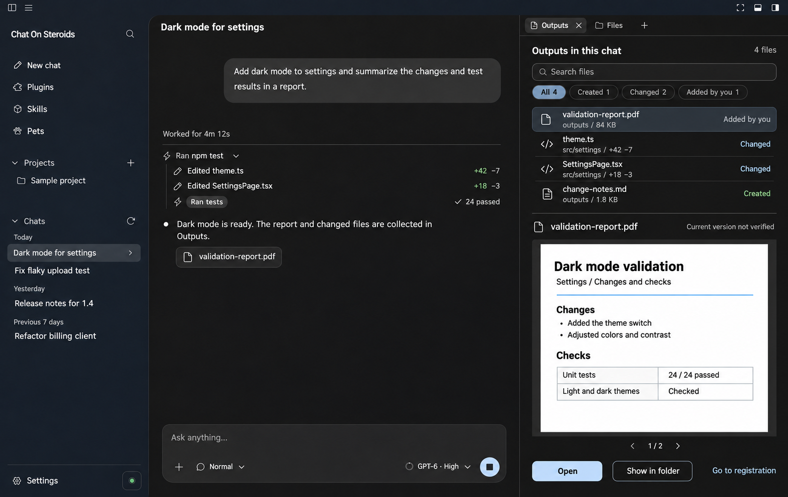

# Proposal: find a chat's outputs without searching its transcript

Status: draft for scope discussion, before implementation.

A person asks ChatGPT to change some code or produce a document. Later, they want to open
the result, inspect what changed, or find the message that produced it. Today, Files browses
the project's directory tree, while recorded edit cards belong to individual tool calls.
An **Outputs** dock would collect those results for the selected chat without replacing
either view or making a second file manager.

## Screen concept

This is a generated UI concept using synthetic content and the existing app screenshot as
its visual reference. It is not a running implementation or evidence of working tests.
The filenames, file sizes, change counts and test results are illustrative. The interface
is shown in English; an implementation would use the app's normal localization system.

The right dock keeps the conversation visible. Its upper section lists files associated
with this chat, with search and Created/Changed/Added by you filters. Selecting a row opens its details
below: a supported file preview or the recorded edit, plus **Open**, **Show in folder** and
**Go to source activity**. The last action returns to the exact recorded tool call; a
manually added reference returns to its registration point instead.

## Recommended first scope

- One optional Outputs tool tab in the existing right dock, scoped to the selected durable
  session. Existing Files and Review remain unchanged.
- Populate rows from explicitly recorded file changes, retaining the originating session,
  tool-call and change identity. No extraction of guessed paths from assistant prose or
  terminal stdout, and no recursive filesystem scan on opening the tab.
- Offer an explicit **Add to outputs** action on a file in Files for a result created by a
  shell command or external app that has no structured file-change receipt. Mark that row
  as **Added by you**, not proof that the chat created it. This is the proposed way to
  include the sample PDF; its existence cannot be inferred just from an assistant claim.
- Group repeated recorded changes to the same session/project-relative path into one row
  with access to its source activities. A manual reference can join that row without becoming a recorded
  creation. Recorded deletion stays distinguishable from a file currently missing on disk.
- Reuse the existing bounded text/image/PDF preview and immutable recorded-diff readers
  where applicable. A recorded diff describes that edit, not today's whole filesystem
  diff. Unsupported previews still offer the source activity and permitted file actions.
- Keep the list paginated and metadata-first. Read file content only when selected; do not
  load full transcripts, every diff or every PDF just to render the list.

The first implementation should cover project-backed chats only. An unfiled chat should
explain that limitation and keep its existing transcript/edit cards usable. Cross-project
aggregation, automatic shell-output discovery, sharing, editing, deletion, applying changes
and background file monitoring are outside this proposal.

## Fit with existing owners

- [`ToolCallRecord.changes`](../../src/shared/session.ts) records demonstrated file changes;
  the recorder/store should remain authoritative for their provenance.
- [`readToolEditReview`](../../src/main/session/store.ts) and
  [`tool-artifacts.ts`](../../src/renderer/tool-artifacts.ts) already support bounded,
  immutable per-call edit review. The dock should reuse this meaning, not invent a new diff.
- [`ProjectFilePreview`](../../src/shared/project-files.ts) already supports text, raster
  images and bounded PDF bytes. Existing project-file operations and
  [`preload`](../../src/preload/index.ts) provide the starting boundary for previews/reveal.
- [`workspace-docks.ts`](../../src/renderer/workspace-docks.ts) owns the dock lifecycle;
  [`AGENTS.md`](../../AGENTS.md) describes its current identity and permission invariants.

An Outputs projection should not become another authority for recorded changes. Manual
references would be small, separately identified session metadata; their schema and migration
need agreement before implementation. Existing recordings with no such metadata remain valid.

## File state and permission boundaries

A recorded path is history, not a new access grant. Main must re-resolve the current project
and approved roots for each live preview, open or reveal action, including symbolic links
and Windows path variants. The renderer receives only the bounded data that action permits.
Native opening uses existing confirmation policy and must never treat an executable or
script as a harmless preview. Opening the tab itself executes nothing.

Show **Missing**, **Access unavailable** or **Changed since recorded** only when supported
by current evidence. When the record cannot establish a comparable revision, show
**Current version not verified** rather than claiming the file is unchanged. Keep a recorded
diff readable when its current file is gone, subject to the existing history access policy.

An older path does not prove a renamed file is the same file. Update a reference only with
an explicit rename receipt or user action; never guess by basename. Source-jump provenance
also survives Compact & Resume, which changes the frontend chat rather than the local session.
Worker changes remain with their recorded owner in the first version; do not silently fold
another chat's files into the current chat.

## Acceptance cases for an implementation

- Empty chat; repeated edits; a manually added file; deleted or renamed files; and missing
  or damaged edit assets. Preserve recorded history even when a live preview is unavailable.
- A shell-created PDF appears only after explicit registration, not from matching a path in
  prose. A successful command alone is not a file-creation receipt.
- Restart with an old recording, missing manual-reference metadata or damaged references;
  no chat is rewritten merely because its Outputs tab was opened.
- A revoked root, symlink/junction change or foreign-session request cannot gain live file
  access. Validate the exact selected session/project after asynchronous operations.
- Switching A to B to A while a preview loads cannot display B's content in A. Closing the
  dock releases its preview resources without closing unrelated terminals or worker views.
- Large histories/files stay within bounded pages and existing preview limits; unavailable
  previews do not prevent listing the other outputs.
- Keyboard selection and focus return, light/dark themes, narrow docks and every supported
  locale. Verify the flow in the actual Electron app with synthetic data.

These are proposed acceptance requirements; this documentation-only PR does not implement
or test them.

## Maintainer decisions requested

1. Does a chat-scoped Outputs tab solve a useful problem alongside Files and Review?
2. Is recorded file-change metadata plus explicit user registration the right initial source,
   or should the first implementation be limited to recorded edits alone?
3. Is the list/detail layout above suitable for the existing dock, and should inline PDF
   preview be included immediately using the existing viewer?

Agree the initial scope here before building the feature. This proposal changes no app,
IPC, permission, recorded-event or extension contract.
