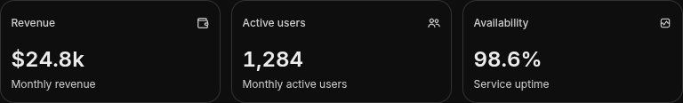
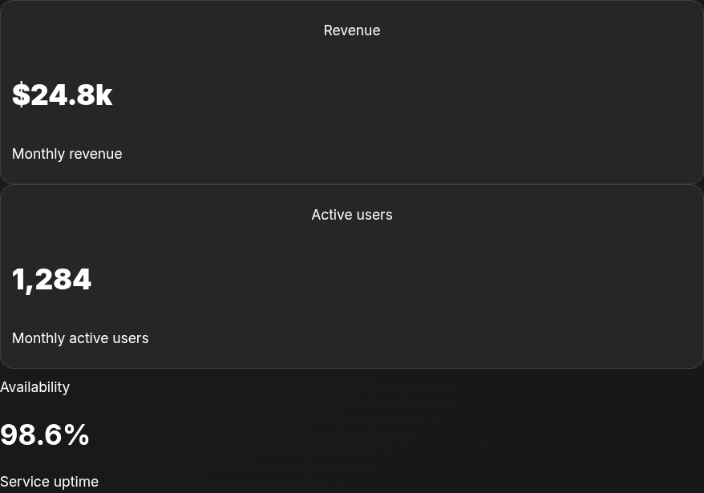
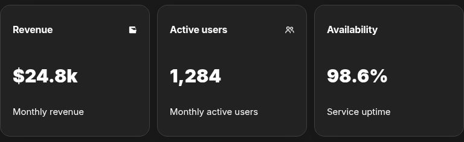

# One English static Bento: native reply and recorded timeline

This answers the capture-format question with a **single fictional English QA
reply**. The contributor explicitly requested a new example and generated it once
in ChatGPT. The same completed answer is used throughout; it was not regenerated
for CoS. Only component crops are published, without browser chrome, account
information, chat identifiers or private content. This PR remains documentation
and images only; no experimental runtime implementation is included.

## Same English reply in ChatGPT and the installed app

The answer is titled **Sample business overview** and contains exactly:

| Label | Value | Description |
| --- | --- | --- |
| Revenue | $24.8k | Monthly revenue |
| Active users | 1,284 | Monthly active users |
| Availability | 98.6% | Service uptime |

| ChatGPT original | Installed CoS, as observed by the contributor |
| --- | --- |
|  |  |

These are unaltered crops of the contributor's supplied desktop screenshot. The
original component is 768 raster pixels wide, corresponding to a live DOM width
of 768 CSS px; the installed-app crop is **878 px wide**. The table scales the
images to fit; open them at original size. The installed screenshot demonstrates
structural loss, **not a normalized typography or geometry comparison**: its zoom,
font, settings and exact installed build were not independently recorded.

The native answer has one three-column row of equal cards. The installed timeline
stacks the first two metric panels and leaves Availability as ordinary text.
All labels/values remain legible, but the shared grid and final box are missing.
No image was translated, retouched or resized to create this evidence.

## What is already recorded, and where structure is lost

The original saved answer contains the three typed grid items/boxes, all exact
labels/values, `grid-template-columns: repeat(3, minmax(0px, 1fr))`, and typed
rows/title/text nodes with size/weight enums. There are no charts, forms, actions
or external images in this example. Its saved HTML is approximately 11.5k chars,
is not truncated and already contains the structural data needed for this scope.

At this proposal's code base, `restoreRecordedDilLayouts` selects cards, bordered
box panels, steps and photos, **not a standalone grid**. The individual boxes are
therefore panel candidates rather than one shared grid candidate. Its panel
minimum is five `visibleWords` tokens. Applying that existing tokenizer to the
recording gives:

| Card | Existing visible-word token count | Passes five-token panel minimum? |
| --- | --- | --- |
| Revenue | 6 | Yes |
| Active users | 6 | Yes |
| Availability | 4 | No |

Currency and number tokens count according to the existing tokenizer; these are
not English keyword tests. This explains the observed two-panel/one-plain-metric
pattern from the current source owners. The screenshot is an installed-app
observation, not proof that the current upstream `main` was built and exercised.
Do not simply lower the guard for every panel: match a complete bounded static
grid through the existing canonical-text and sanitizer checks.

## Controlled experimental replay at the original useful width

The same saved reply was imported read-only into the isolated prototype and loaded
in its actual compiled timeline with in-memory IPC. Both experimental states use
**768 CSS px, dark theme, zoom 1/DPR 1 and the same default app font**. The before
state uses the archived stylesheet from before the narrow margin correction; the
after state uses the current stylesheet. This isolates the CSS delta without
changing the answer or invoking the provider. The prototype is not upstream main,
the installed application or a fresh capture by the modified paired extension.

| Experimental stylesheet before margin correction | Experimental current stylesheet |
| --- | --- |
|  |  |

| Measured detail | ChatGPT native DOM | Experimental before | Experimental after |
| --- | --- | --- | --- |
| Useful grid width | 768 px | 768 px | 768 px |
| Columns / card width | 3 / 248 px | 3 / 248 px | 3 / 248 px |
| Grid gap | 12 px | 12 px | 12 px |
| Card height | 116 px | 219.6 px | 152.5 px |
| Metric title block height | 32 px | 36 px | 36 px |
| Card edge-to-content inset | 13 px | 21 px | 21 px |
| CoS metric heading top/bottom margins | Not read directly | 16.5 / 16.5 px | 0 / 0 px |

Removing ordinary Markdown margins only from typed title/text descendants of
structured grid boxes reduces excess height while preserving labels, values and
order. **That margin correction needs no new recorded field.** It is diagnostic:
its experimental selector alone would not restore the grid in upstream.

Spacing expressions, including logical padding and inner gaps, remain recorded
as private-token expressions rather than resolved lengths. The grid gap happens
to match in this example; this does not justify assuming token values generally.
Typography, padding, surface colour, icons and radius still differ. The native
font family, zoom and DPR were not independently read for this new response;
DOM bounds and the native crop agree on useful width. No normalized font/asset
comparison, pixel-diff score or full visual parity is claimed.

English-specific verification exercised both compiled-timeline states and checked
all three exact card texts/values/order, widths, current zero heading margins and
absence of outer overflow. Images wait for compositor acknowledgement. No runtime
code changed for this English evidence refresh. The previous local Linux margin
regression run passed 437 focused tests, typecheck, build and targeted Electron
checks; those historical results are not a new full-suite run for this example.
Full `npm run verify`, the full UI suite and Windows/macOS remain unverified here.

## Proposed first contribution

Keep the PR a draft for product/design review. A small separate renderer change
should recover a complete static grid through `restoreRecordedDilLayouts` and its
existing matching/sanitization owner, handle short metric labels without dropping
one card, and control structured-card spacing. This example already holds the
structural attributes, so a new capture format is not justified for that first
scope. Resolved private tokens need a separate decision if later fidelity work
requires them. Defer charts, controls, callbacks, settings and widget snapshots;
keep today's Markdown fallback. Reproduce against the implementation PR's actual
upstream base and complete the normal gates before submission. Do not submit the
accumulated experimental prototype wholesale.
