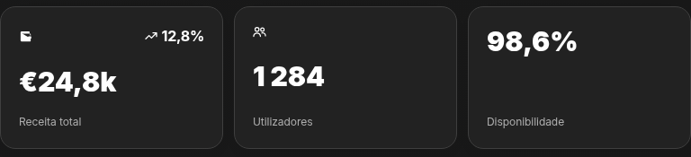

# One static Bento: native reference and recorded timeline

This answers the capture-format question in the proposal with one **existing,
fictional ChatGPT reply**. Nothing was regenerated. Only the three metric cards
are shown; no account, browser chrome, conversation identifiers or private data
appear. This PR still contains **documentation and images only**. Experimental
runtime code is not included and is not proposed as a single implementation PR.

## Capture conditions and limits

- Same already-generated labels/values: €24,8k, 1 284, 98,6% and 12,8%.
- Useful component width: **768 CSS px** in both interfaces; dark theme.
- Native browser zoom: 100%, confirmed by the person; desktop scale: 1.
  The native crop is 768 raster pixels wide. The protected read-only connector
  exposed DOM bounds, but not the font family or DPR directly.
- CoS: actual compiled experimental timeline, zoom 1/DPR 1, default app font,
  read-only offline import and in-memory IPC. **Not upstream main, the installed
  app, or a fresh capture through the modified paired extension.**
- CoS frames wait for compositor acknowledgement. Native image is a desktop
  crop restricted to the cards. Images retain their original scale; only cropping
  was applied. Font/assets readiness was not independently instrumented in the
  protected native page. This is not a pixel-diff score or proof of full parity.

## Same fictional reply, side by side

| ChatGPT original | CoS experimental baseline |
| --- | --- |
|  |  |

Open the images at original size to compare at 768 px; the Markdown table scales
them to fit. The baseline has the three columns and exact text, but its cards are
too tall and its type hierarchy, colours and icons differ.

## What is lost, and where

| Detail | Native / baseline CoS | Already recorded? | Smallest owner to change |
| --- | --- | --- | --- |
| Three-column hierarchy and order | Present in both | Yes: typed grid/items and `repeat(3,…)` hint | No new format needed |
| Standalone grid recovery in upstream | The experimental baseline restores the row; upstream has not been demonstrated here | The original recording has the grid/items/boxes | Investigate the existing `restoreRecordedDilLayouts` candidate/matching path, not a second renderer |
| Extra title/paragraph margins | No authored margins on native typed text; CoS metric heading has 16.5 px above and below | Typed `title`/`text` markers are present; these margins come from CoS Markdown CSS | Renderer-only reset within structured grid-card boxes |
| Grid gap | 8 / 12 px | Inline expression is stored: `calc(var(--spacing, 0.25rem) * 2)`; resolved token is not | Separate capture decision if exact computed geometry is needed; do not assume a private variable's value |
| Card edge-to-content inset | 13 / 21 px | Logical padding expressions are stored; resolved lengths are absent | Separate bounded computed-geometry question |
| Metric title height | 28 / 36 px | Size/weight enums exist, but are not fully mapped | Investigate bounded enum mapping in the existing renderer |
| Icons, surfaces, radius and font | Still visibly different | Coverage varies; provider tokens/styles are unavailable | Out of the first margin fix; no raw CSS/JS replay |

At this proposal's code base, `restoreRecordedDilLayouts` considers cards, bordered
box panels, steps and photos; a standalone grid is not a candidate. Its panel
minimum-word guard can also exclude short metric cards. This is source inspection,
not an upstream runtime result. A margin-only patch to the experimental selector
would not, by itself, add this grid recovery to upstream.

Native card width is approximately 250.7 px; baseline CoS is 248 px because of
the different grid gap. The reported insets and dimensions come from live DOM
bounds; unknown computed properties have not been filled with invented values.

## One isolated renderer experiment

Removing ordinary Markdown margins **only from typed title/text descendants of
grid-card boxes** reduces card height from **209.6 to 159 px**, against **114.2 px**
in the native reference. All recorded labels/values and column order stay equal.
No capture field, provider callback, setting or interaction is added. Ordinary
Markdown outside those cards retains its margins.

This remains visibly incomplete: the grid gap, padding, typography, icons and
surface styling still differ. The after image shows the same local experimental
baseline plus the narrow CSS correction, not the behavior of this docs-only PR.

The new regression failed before the CSS correction and passed afterwards.
Local Linux checks: 437 focused tests in 16 files (including four opt-in recorded
QA probes), typecheck, build and the Electron geometry/gallery check passed.
The gallery check covers six theme/width layouts. Full `npm run verify`, the full
UI suite and Windows/macOS rendering were not run for this experiment.

## Proposed next contribution

Keep this PR a draft for product/design review. A separate, small renderer-only
contribution should demonstrate a complete static grid through the existing
`restoreRecordedDilLayouts` matching/sanitization owner, including short metric
labels and controlled card spacing. The original recording already contains the
structural attributes; the margin experiment needs no new fields. Prove that scope
against upstream before choosing any capture-format change. Defer charts, controls
and widget snapshots, and keep today's Markdown fallback. The broader prototype
must not be submitted wholesale. Complete the normal upstream validation and a
comparison against the implementation PR's actual base before submission.
